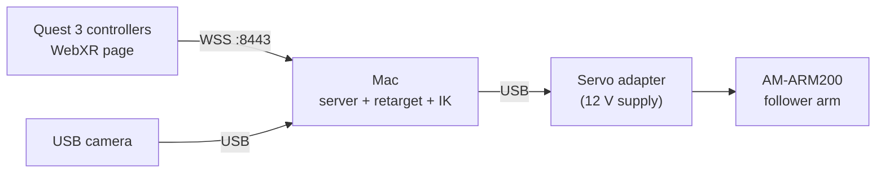
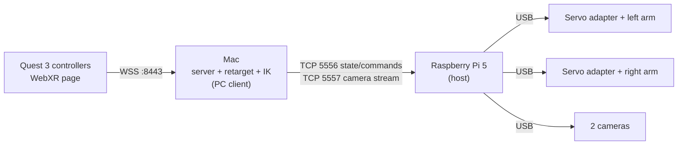

# MicronBot: Robot Learning

Nov 23, 2026 · Jackie

This doc records three robot-learning trials on MicronBot (the third is optional), an adaptation of the AlohaMini dual-arm mobile robot for assembly and test warehouse work. Both use Quest 3 controllers as a fake leader arm, with no physical leader arm.

|  | Trial 1: MicronArm | Trial 2: MicronBot | Trial 3 (optional): Autonomous base |
| --- | --- | --- | --- |
| Scope | One AM-ARM200 follower arm | The whole robot: two arms, cameras and base | Fully autonomous operation: the base navigates itself with SLAM, and the policy does the manipulation |
| Connection | The Mac connects by USB straight to the servo adapter and the camera | The Pi 5 connects to three servo adapters (left arm, right arm, mobile base) and five cameras, and the Mac controls it over SSH and the local network | Same as Trial 2, plus a 2D lidar on the base and a navigation stack. Policy inference runs on the Mac or a GPU machine over the network |
| Reference | [am-arm200.md](https://github.com/liyiteng/lerobot_alohamini/blob/main/docs/alohamini/am-arm200.md): one arm, one PC | [alohamini.md](https://github.com/liyiteng/lerobot_alohamini/blob/main/docs/alohamini/alohamini.md): Pi host, PC client | alohamini.md for the robot, plus ROS 2 Nav2 and slam_toolbox (proposed, not in the repo) |
| State | In progress: arm, camera and URDF verified, Quest test pending | Not started: the Pi is not reachable over SSH yet | Optional: only if free roaming is needed, after Trials 1 and 2 work |

## Trial 1: MicronArm, single arm with the Mac connected directly

Trial 1 follows `am-arm200.md`: one follower arm and one camera on the Mac, driven by Quest 3 controllers.

**Goal:** to be determined.

### Status

The arm, camera, calibration and URDF are set up and verified on the Mac. Quest streaming is partly done, and everything from IK retargeting onward has not started. Trial 2, the whole robot on a Raspberry Pi 5, is described after this trial.

| # | Item | State | Note |
| --- | --- | --- | --- |
| 1 | LeRobot (`lerobot_alohamini`) installed on the Mac | Done | |
| 2 | Servo adapter port found | Done | |
| 3 | Follower arm calibrated | Done | Lift and elbow ranges look narrow, see Gotchas |
| 4 | USB camera working at 640x480, 30 fps | Done | |
| 5 | Read joints and camera, send a small motion command | Done | |
| 6 | URDF cleaned, limits from calibration, tip frame added | Done | |
| 7 | URDF vs real arm alignment: zero pose, six joint directions, tip | Done | |
| 8 | Quest 3 controller pose streaming to the Mac | Partly done | Server written; end-to-end test not confirmed yet |
| 9 | Retarget controller pose to the arm with IK (clutch, limits, smoothing) | Not started | |
| 10 | Wrap as a LeRobot teleoperator for recording | Not started | |
| 11 | Record about 50 demos of a box-transfer task | Not started | |
| 12 | Train ACT on a cloud GPU | Not started | |
| 13 | Evaluate on the robot and iterate | Not started | |

### Architecture

The Mac does the work of both the Raspberry Pi and the PC: it reads the Quest, computes the IK and drives the arm over USB.



Solid boxes work and are verified today. The Quest-to-Mac link and the retarget and IK stage are not confirmed or built yet. Trial 2 moves the same control loop onto a Pi 5 host, with the Mac as the client over the LAN.

### Hardware and software

The setup is one AM-ARM200 follower arm and one USB camera driven from a Mac, with Quest 3 controllers acting as the leader.

**Hardware**

- AM-ARM200 follower arm: 6+1 DoF (six joints plus gripper), STS3215 and STS3095 servos
- Waveshare servo controller (USB) and a 12 V supply. USB alone does not power the servos.
- Mac (Apple silicon laptop)
- USB camera: macOS camera index 2, 1080p native, used at 640x480 and 30 fps
- Meta Quest 3 and controllers, on the same Wi-Fi network as the Mac
- Raspberry Pi 5: not used in this trial (see Trial 2)

**Software**

- Fork [`liyiteng/lerobot_alohamini`](https://github.com/liyiteng/lerobot_alohamini), based on Hugging Face LeRobot
- Python 3.12 in a conda environment named `lerobot_alohamini`
- `placo` for kinematics, installed by the `[all]` extras
- `aiohttp` for the Quest stream server, `matplotlib` for the alignment drawing

### Repo layout

All custom scripts sit in the repo root, the URDFs in `assets/am_arm200/`, and the Quest stream in `quest_teleop/`.

```text
lerobot_alohamini/
├── assets/am_arm200/
│   ├── am-arm200.urdf             # working URDF: renamed joints, real limits, flipped axes, tip link
│   ├── am-arm200.original.urdf    # untouched copy as received
│   └── am-arm200-ik.urdf          # generated kinematics-only copy (no meshes), used by the IK
├── test_follower.py               # connect, read joints and a camera frame
├── test_move.py                   # nudge shoulder_pan by +5 deg and back
├── fk_monitor.py                  # live joint angles and forward-kinematics position
├── align_check.py                 # live skeleton from the URDF vs the real arm
├── patch_limits.py                # writes calibration ranges into the URDF as joint limits
├── build_urdf.py                  # axis fixes, tip link, regenerates the IK URDF
└── quest_teleop/
    ├── index.html                 # WebXR page, runs in the Quest browser
    ├── server.py                  # HTTPS and WebSocket server, prints controller data
    └── cert.pem, key.pem          # self-signed certificate (do not commit)
```

Copies of all these scripts are in [`scripts/`](scripts/), exactly as run on the Mac.

The calibration file is stored outside the repo:

```text
~/.cache/huggingface/lerobot/calibration/robots/so_follower/my_follower.json
```

Suggested `.gitignore` entry:

```text
quest_teleop/*.pem
```

### Step 1: Install on the Mac

The fork installs into a Python 3.12 conda environment (Miniforge is installed first). The fork's install guide documents Ubuntu x86-64 and Raspberry Pi ARM64, so macOS is not a documented target, but it worked here.

```bash
git clone https://github.com/liyiteng/lerobot_alohamini.git
cd lerobot_alohamini
conda create -y -n lerobot_alohamini python=3.12
conda activate lerobot_alohamini
pip install -e ".[all]"
pip install pyzmq feetech-servo-sdk
conda install -y ffmpeg=7.1.1 -c conda-forge
pip install aiohttp matplotlib
```

- `-e` installs the repo in editable mode, so code changes apply without reinstalling.
- `feetech-servo-sdk` is the servo driver. `ffmpeg` encodes and decodes the dataset videos.
- If `pip install -e ".[all]"` fails on macOS, `pip install -e .` plus the two extra packages is enough for teleop and recording.

Check the install:

```bash
python -c "import lerobot; print('lerobot ok')"
python -c "import placo; print('placo ok')"
```

### Step 2: Find the servo port

The servo adapter shows up on macOS as `/dev/tty.usbmodemXXXXXXXX`. Find it with LeRobot's port finder:

```bash
lerobot-find-port
```

Follow the prompt: unplug the adapter's USB cable, then press Enter. It prints the port that disappeared. The port in this setup was `/dev/tty.usbmodem5C931508261`.

- The adapter also needs the 12 V supply connected, not just USB.
- Port names can change after a reconnect or reboot, so run the finder again if the arm is not found.

### Step 3: Calibrate the follower

The follower is calibrated on its own, with no leader arm. The command comes from `docs/alohamini/am-arm200.md` section 3, and the port is passed as a flag, so no config file needs editing:

```bash
lerobot-calibrate \
    --robot.type=so101_follower \
    --robot.port=/dev/tty.usbmodem5C931508261 \
    --robot.id=my_follower \
    --robot.arm_profile=am-follower-6dof
```

For the AM-ARM200 Pro, use `am-follower-6dof-hd` as the arm profile.

- If a calibration file for that id already exists, the script asks whether to reuse it. Type `c` to recalibrate.
- Put the arm in the middle of its range and press Enter. Then move every joint slowly to both mechanical stops and press Enter again.
- Power-cycle the arm after calibrating, as the doc requires.

The saved calibration gives these limits, as half-range about the calibrated midpoint:

| Joint | Half-range (degrees) |
| --- | ---: |
| `shoulder_pan` | 125.5 |
| `shoulder_lift` | 31.2 |
| `elbow_flex` | 41.9 |
| `wrist_flex` | 93.5 |
| `wrist_yaw` | 95.3 |
| `wrist_roll` | full turn, not range-limited |

Degrees come from servo ticks (4096 per revolution):

```math
\theta_{\text{half}} = \frac{\text{range\_max} - \text{range\_min}}{2} \cdot \frac{360}{4095}
```

`use_degrees` defaults to `True` in the follower config, so joint readings are in degrees.

### Step 4: Cameras

Camera ID 2 is the one in use, configured at 640x480 and 30 fps. List the available cameras and save a test frame from each:

```bash
lerobot-find-cameras
```

Three sources were listed on the Mac, and test frames were saved to `outputs/captured_images`. The correct source was identified by opening those images.

- On macOS the list can include the built-in camera and a nearby iPhone (Continuity Camera), so the IDs are not only the cameras you plugged in.
- Camera 2 reports 1920x1080 at 30 fps natively. It was configured at 640x480 and returns frames of shape (480, 640, 3).
- Camera IDs can reorder when devices are plugged or unplugged. Keep the cameras connected the same way, and recheck after changes.
- macOS may ask to let Terminal use the camera. Click Allow.

### Step 5: Link test

The Mac can read the arm and camera and command a small motion, which confirms the whole serial and camera path before any teleoperation work.

`test_follower.py` connects the arm with the camera and reads one observation:

```python
from lerobot.cameras.opencv import OpenCVCameraConfig
from lerobot.robots.so_follower import SOFollower, SOFollowerRobotConfig

config = SOFollowerRobotConfig(
    port="/dev/tty.usbmodem5C931508261",
    id="my_follower",
    arm_profile="am-follower-6dof",
    cameras={"camera2": OpenCVCameraConfig(index_or_path=2, width=640, height=480, fps=30)},
)
robot = SOFollower(config)
robot.connect()
obs = robot.get_observation()   # joint .pos values in degrees + camera frame (480, 640, 3)
robot.disconnect()
```

Run it from the repo root:

```bash
python test_follower.py
```

The verified output was seven joint readings (`shoulder_pan.pos` through `gripper.pos`) and `camera2: image (480, 640, 3)`.

`test_move.py` reads the current positions, ramps `shoulder_pan` by +5 degrees over about 0.5 s with `robot.send_action(...)`, and ramps back:

```bash
python test_move.py
```

The base moved and returned, so the Mac can command the arm. Connecting turns servo torque on, so keep clear of the joints and the gripper, and keep a hand near the 12 V plug.

### Step 6: URDF for IK

The AM-ARM200 URDF (`am-arm200.urdf`) had four problems for use with LeRobot's IK, and each one is fixed by a script in the repo.

| Problem | Fix |
| --- | --- |
| Joint names did not match LeRobot's motor names (`left_shoulder_pan`, `left_wrist_yaw_joint`, ...) | Renamed to `shoulder_pan`, `shoulder_lift`, `elbow_flex`, `wrist_flex`, `wrist_yaw`, `wrist_roll`, `gripper`. Only the `<joint name=...>` tags change, so link names are untouched. |
| Joint limits were placeholders (plus or minus 3.14 rad, `effort=0`) | `patch_limits.py` writes calibration-derived limits in radians for the five limited joints |
| Mesh paths use `package://am-arm200/am-arm200-meshes/...`, which `placo` cannot resolve | `build_urdf.py` makes a kinematics-only copy, `am-arm200-ik.urdf`, with all `<visual>` and `<collision>` blocks removed |
| No end-effector frame for the IK to target | Added a fixed link `gripper_tip` (below) |

The kinematic chain, confirmed from the `<parent>` and `<child>` tags:

```text
left_Base -> shoulder_pan -> left_Rotation_Pitch -> shoulder_lift -> left_Upper_Arm
-> elbow_flex -> left_Lower_Arm -> wrist_flex -> left_Wrist_Pitch_Roll
-> wrist_yaw -> left_wrist_yaw -> wrist_roll -> left_Fixed_Jaw
     |- gripper -> left_Moving_Jaw
     |- left_camera_joint8 (fixed) -> left_camera
```

The two axis fixes (found in the alignment check) are applied by `build_urdf.py`:

```python
AXES = {
    "shoulder_lift": "0 0 1",   # was 0 0 -1
    "wrist_roll":    "0 0 -1",  # was 0 0 1
}
```

The tip link sits 70 mm along the +y axis of `left_Fixed_Jaw`, which is the gripper's roll axis and points toward the fingertips:

```xml
<link name="gripper_tip" />
<joint name="gripper_tip_joint" type="fixed">
  <parent link="left_Fixed_Jaw" />
  <child link="gripper_tip" />
  <origin xyz="0 0.07 0" rpy="0 0 0" />
</joint>
```

The IK URDF is generated, so rebuild it after every URDF edit. It went stale once, because it was made before the second calibration:

```bash
python patch_limits.py   # calibration -> limits in am-arm200.urdf
python build_urdf.py     # axes + tip link, then regenerate am-arm200-ik.urdf
```

**How LeRobot's IK uses the URDF.** `src/lerobot/model/kinematics.py` defines `RobotKinematics(urdf_path, target_frame_name, joint_names)`, built on `placo`:

- `forward_kinematics(joint_pos_deg)` returns a 4x4 pose of the target frame.
- `inverse_kinematics(current_joint_pos, desired_ee_pose, position_weight=1.0, orientation_weight=0.01)` returns joint angles in degrees. The default orientation weight is small and will be raised to follow the controller's rotation.
- This project uses `urdf_path="assets/am_arm200/am-arm200-ik.urdf"`, `target_frame_name="gripper_tip"`, and the six arm joints as `joint_names`. The gripper is left out, since the trigger drives it.
- Run scripts from the repo root. `placo` treats a path it cannot find as a directory and reports a misleading `.../robot.urdf does not exist` error.

LeRobot also ships `robot_kinematic_processor.py` with `EEReferenceAndDelta`, `EEBoundsAndSafety`, `InverseKinematicsEEToJoints` and `GripperVelocityToJoint`. These have been identified by name but not read or used yet.

### Step 7: Alignment check (URDF vs real arm)

After two axis flips and the tip link, all six arm joints and the zero pose match the real arm. An unverified URDF makes the IK aim wrong even when the code is right, so the model was checked in two ways, both with torque off and the arm supported by hand.

#### 7a. Link lengths

`fk_monitor.py` prints the live joint angles and the forward-kinematics position of the wrist point. The arm was held in two poses, and the model's displacement was compared with a ruler measurement of how far the real wrist moved:

```bash
python fk_monitor.py
```

| Pose | x (mm) | y (mm) | z (mm) |
| --- | ---: | ---: | ---: |
| A: folded rest | -9.7 | 65.3 | 56.3 |
| B: forearm raised | -10.7 | -27.2 | 269.9 |

```math
d = \sqrt{\Delta x^2 + \Delta y^2 + \Delta z^2} = \sqrt{(-1.0)^2 + (-92.5)^2 + (213.6)^2} \approx 232.8\ \text{mm}
```

The ruler distance agreed with the model. (It was reported as matching; the exact number was not recorded.) This validates the link lengths of the pitch joints in one plane. Comparing displacements avoids needing to know where the URDF origin sits.

#### 7b. Live skeleton: zero pose and joint directions

`align_check.py` draws the URDF's forward-kinematics skeleton live, in side and top views, from the real joint angles while the arm is moved by hand. It also draws a red, green and blue triad for the tip frame:

```bash
python align_check.py
```

| Check | Result |
| --- | --- |
| Zero pose (all joints about 0 degrees) | Matches the real arm, so the URDF zero is LeRobot's calibrated midpoint |
| `shoulder_pan` | Matches (both turn clockwise from above when increasing) |
| `shoulder_lift` | Mirrored, so the URDF axis was flipped |
| `elbow_flex` | Matches (also confirmed the viewing side was right) |
| `wrist_flex` | Matches |
| `wrist_yaw` | Matches |
| `wrist_roll` | Mirrored, so the URDF axis was flipped |
| Gripper pointing axis | Green, the local y of `left_Fixed_Jaw`: the axis that stays still when the wrist rolls |
| Tip frame | 70 mm along +y lands at the midpoint between the fingertips |

Not checked: the gripper jaw joint (driven directly by the trigger, not by IK) and workspace accuracy beyond the tested motions.

### Step 8: Quest 3 controller streaming

The server is written and starts, but an end-to-end run, with the Terminal printing controller values from the headset, has not been confirmed yet.

The goal is to get controller pose, trigger and grip from the Quest to the Mac. The headset must be on, because it tracks the controllers with its cameras, but the VR view can be blank. The approach is a WebXR page served from the Mac and opened in the Quest browser. It reads each controller's grip pose and gamepad buttons every XR frame and sends JSON over a secure WebSocket. WebXR requires HTTPS, so the server uses a self-signed certificate.

Find the Mac's IP address:

```bash
ipconfig getifaddr en0
```

Create the certificate and start the server, replacing `<MAC_IP>` with that address:

```bash
cd quest_teleop
openssl req -x509 -newkey rsa:2048 -nodes -keyout key.pem -out cert.pem -days 365 \
  -subj "/CN=<MAC_IP>" -addext "subjectAltName=IP:<MAC_IP>"
python server.py
```

The server then listens on `https://0.0.0.0:8443`. On the Quest:

1. Put the headset on and open the Meta Quest Browser.
2. Go to `https://<MAC_IP>:8443`.
3. Click through the certificate warning (Advanced, then proceed).
4. When the page says "Socket connected", tap **Enter VR**.
5. Move the controllers, squeeze the grips and press the triggers.

Expected on the Mac: `Quest connected`, then a line about every half second with the update rate and both controllers' position, trigger and grip.

The message sent for each frame:

```json
{"t": 12345.6, "hands": {"right": {"pos": [0.12, 1.05, -0.30], "quat": [0, 0, 0, 1], "trigger": 0.0, "grip": 0.0, "a": 0, "b": 0}}}
```

- macOS may ask to allow incoming connections for Python. Click Allow.
- The Quest and the Mac must be on the same Wi-Fi network. Some campus or corporate networks isolate devices from each other. A phone hotspot that both devices join is the workaround.

**Is the VR view required?** The headset has to be on and tracking, but the VR view itself is not needed. The Quest controllers do not track themselves: the headset's cameras see them, and they talk to the headset, not to a Mac. **Enter VR** only starts the tracking session that lets the browser read the controller poses, and the scene is a blank colour. Only the right controller drives the arm. The page sends both, and the server can ignore the left.

To avoid wearing the headset, mount it on a stand facing the workspace with the right controller in its camera view. The Quest sleeps when its proximity sensor says it is not worn. A developer-mode override exists for that, but it has not been tested here.

### Roadmap

The next milestone is a working controller-to-arm loop; recording, training and evaluation follow from it.

1. **Finish the Quest stream test.** Record the update rate and the controller coordinate axes.
2. **Retarget with a clutch.** Use relative motion, so the controller's absolute position in the room does not matter. While the grip is held:

   ```math
   \mathbf{x}_{\text{target}} = \mathbf{x}_{\text{arm}}^{0} + s\,R\,(\mathbf{x}_{\text{ctrl}} - \mathbf{x}_{\text{ctrl}}^{0})
   ```

   The superscript 0 marks the pose captured when the grip was pressed, s is a motion scale, and R maps the Quest frame to the arm's base frame. Orientation is handled the same way with relative rotations.
3. **IK to joints** with `RobotKinematics(... target_frame_name="gripper_tip", joint_names=<six arm joints>)`, with joint limits, workspace bounds, per-step delta limits and smoothing. The trigger drives the gripper.
4. **Safe first run.** Slow motion, small deltas, a hand on the 12 V plug. Joint-direction sign errors are already ruled out by the alignment check.
5. **Wrap as a LeRobot teleoperator** so the existing record script can use it, and add the wrist camera and a second camera if useful.
6. **Record about 50 demonstrations** of one box-transfer task. See `docs/alohamini/am-arm200.md`, section 5, for the record flow.
7. **Train ACT on a cloud GPU.** Training needs CUDA, and Apple silicon is not enough. Copy the checkpoint back to the Mac.
8. **Evaluate** about 20 trials per policy version on the robot. Change one thing at a time (data, chunk size, cameras) and repeat.
9. **Move onto the Raspberry Pi 5** host with the Mac as the client, then add the second arm and the mobile base.

Concepts used in the project: imitation learning from teleoperated demonstrations, ACT (action chunking with a CVAE), and later Diffusion Policy and VLA models such as SmolVLA and pi0.

## Trial 2: MicronBot, whole robot with a Pi 5 host and the Mac as client

Trial 2 runs the whole robot. The Raspberry Pi 5 on the robot connects to three servo adapters (left arm, right arm, mobile base) and five cameras (one on each arm, one on the lifter chest, two on the head), and the Mac controls it as the PC client over SSH and the local network. Quest 3 controllers still act as the fake leader arm. It follows `alohamini.md`. It has not started: the Pi has no SSH access yet.

**Goal:** use MicronBot to unpack a cardboard box and clear it away, in two tasks:

1. Open the cardboard box with a knife.
2. Transfer the empty box to another empty area.

### Architecture

The Pi 5 owns the arms and cameras, and the Mac talks to it over the network.



The Mac sends joint commands to the Pi host and receives state and camera frames back over TCP 5556 and 5557. The Quest stream and the IK stay on the Mac, as in Trial 1.

### Hardware and the alohamini.md workflow

The Pi 5 owns every robot-side device, and the Mac only needs the network. Per the plan:

- Raspberry Pi 5, with the RAM size not yet confirmed
- Three servo adapters (left arm, right arm, mobile base) and five cameras (one on each arm, one on the lifter chest, two on the head). That is more USB devices than the Pi's four ports, so the port and camera layout still needs to be confirmed. The doc says each camera needs its own USB port, not a shared hub.
- 12 V supply for the servos, and a separate power supply for the Pi
- Mac as the PC client, plus the Quest 3 controllers
- Wi-Fi works, but an Ethernet cable to the router gives lower latency for teleoperation

The workflow in [alohamini.md](https://github.com/liyiteng/lerobot_alohamini/blob/main/docs/alohamini/alohamini.md) sets the serial ports in `src/lerobot/robots/alohamini/config_alohamini.py` on the Pi:

```python
@dataclass
class AlohaMiniConfig(RobotConfig):
    left_port:  str = "/dev/ttyACM0"   # replace with your left-bus port
    right_port: str = "/dev/ttyACM1"   # replace with your right-bus port
```

Camera indices are set in the same file after running `lerobot-find-cameras`. `alohamini2` is the AM-ARM 6-DoF follower with an 18-dim state. Calibrate the followers, then start the host, both on the Pi:

```bash
python -m lerobot.robots.alohamini.alohamini_calibrate --robot_model alohamini2
python -m lerobot.robots.alohamini.alohamini_host --robot_model alohamini2
```

Add `--camera-stream` to the host command to expose the camera stream on TCP 5557. State requests use TCP 5556. The host gives control to the first command client and stops motion if that client sends nothing for 1 second by default.

On the Mac, the doc's scripts reach the host with `--robot.remote_ip <Pi_IP>`:

```bash
python examples/alohamini/replay_bi.py \
  --dataset.repo_id $HF_USER/am2_bi_test \
  --dataset.episode 0 \
  --robot.remote_ip <Pi_IP> \
  --robot.robot_model alohamini2
```

The doc's `teleoperate_bi.py` and `record_bi.py` require a leader arm, so they cannot be used with the Quest. Our own Quest client will talk to the host the same way.

### What changes from Trial 1

The Quest stream, the retargeting math, the IK and the URDF tooling carry over unchanged. Only the robot-side connection and its conventions change.

**Carries over**

- The Quest page and server, which stream controller pose, trigger and grip to the Mac
- The clutch retargeting math and the `RobotKinematics` IK with `placo`
- The URDF, `build_urdf.py`, `patch_limits.py` and the `gripper_tip` frame
- Recording, training and evaluation, which run on the Mac

**Changes**

- **The robot object.** Instead of `SOFollower` over USB, the Mac uses the AlohaMini client over the network. The client class has not been read yet.
- **Units and names.** The AlohaMini config defaults to `use_degrees = False`, and its joint names may be prefixed with left and right. The IK needs degrees.
- **Calibration** is redone on the Pi with the AlohaMini calibration script, so the Trial 1 calibration file does not carry over.
- **Alignment** must be rechecked on this path, since the zero pose and joint directions can differ.
- **Two arms.** The URDF is the left arm. The right arm needs a mirrored URDF, and each controller maps to its own arm.
- **Cameras** come from the Pi's camera stream, not directly from the Mac.

To keep the switch cheap, the control loop is written against a small `ArmInterface` with `read_joints_deg()` and `send_joints_deg(q)`. In Trial 1 it wraps `SOFollower`, and in Trial 2 only that wrapper changes.

### Moving the base in Trial 2

Trial 2 has no SLAM or lidar, so the base moves in one of three ways. Use them in this order:

1. **Teleoperate the base.** Drive with the keyboard (supported by the repo) or the Quest joystick. The policy handles the arms and lift. Start here.
2. **Policy-driven base.** The action space includes base velocity (x.vel, y.vel, theta.vel), so demos that include driving let ACT or pi0 reproduce short, repeatable moves, such as a fixed path between two stations. There is no obstacle awareness, so use it only in a clear, controlled area.
3. **Marker-based navigation.** Put an AprilTag at each station. The robot sees the tag with its normal camera and drives toward it. This needs no map and also gives the repeatable docking pose the policy needs.

What Trial 2 does not have is obstacle avoidance or long-distance localization. That is Trial 3.

### Planned steps

The first blocker is getting SSH access to the Pi. None of these steps has been run yet, and the Pi's RAM size is not confirmed.

1. **Flash the Pi** with Raspberry Pi OS (64-bit) using Raspberry Pi Imager. In its settings, set a hostname, username, password and Wi-Fi (the same network as the Mac), and enable SSH.

   ```bash
   brew install --cask raspberry-pi-imager
   ```

2. **SSH in from the Mac.** If the `.local` name does not resolve, use the IP from the router's device list.

   ```bash
   ssh <username>@micronbot.local
   ```

3. **Install the same environment on the Pi**, using the Linux ARM64 Miniforge installer, then the same clone, environment and `pip` steps as Trial 1, Step 1. Add the Pi user to the serial group and reboot.

   ```bash
   wget "https://github.com/conda-forge/miniforge/releases/latest/download/Miniforge3-Linux-aarch64.sh"
   bash Miniforge3-Linux-aarch64.sh
   sudo usermod -a -G dialout $USER
   sudo reboot
   ```

   The `[all]` install is heavy for a Pi with little RAM. If it struggles, install a smaller set of packages.

4. **Find both servo ports and the camera indices** on the Pi, then edit `config_alohamini.py`.

   ```bash
   lerobot-find-port
   ls /dev/ttyACM*
   lerobot-find-cameras
   ```

5. **Calibrate both followers on the Pi** and power-cycle the arms.

   ```bash
   python -m lerobot.robots.alohamini.alohamini_calibrate --robot_model alohamini2
   ```

6. **Start the host on the Pi** and check the link from the Mac.

   ```bash
   python -m lerobot.robots.alohamini.alohamini_host --robot_model alohamini2 --camera-stream
   ```

7. **Rerun the alignment check** on the new robot object, then port the Quest control loop to it through `ArmInterface`.
8. **Record, train and evaluate** with the Quest teleoperator, as in the Trial 1 roadmap.

## Policy plan: ACT baseline, then pi0 and GR00T

The plan is to train ACT first as a baseline, then post-train pi0 and GR00T on the same demonstrations and compare all three. We do no pretraining: pi0 and GR00T arrive pretrained, and we only fine-tune them on our own robot data.

| Model | Role | What it is | Fine-tune hardware |
| --- | --- | --- | --- |
| ACT | Baseline, trained from scratch | Small policy in LeRobot, action chunking with a CVAE | Cloud GPU (a Mac cannot train it) |
| pi0 | Stage 2 pretrained model | 3B-parameter flow-matching vision-language-action model from Physical Intelligence, via [openpi](https://github.com/Physical-Intelligence/openpi) or LeRobot's [pi0](https://huggingface.co/docs/lerobot/pi0) | openpi README: LoRA needs more than 22.5 GB (RTX 4090 class), full fine-tuning more than 70 GB (A100 or H100) |
| GR00T N1.7 | Stage 2 pretrained model | 3B-parameter open vision-language-action model from NVIDIA, with a Cosmos-Reason2-2B backbone and a diffusion transformer action head ([Isaac-GR00T](https://github.com/NVIDIA/Isaac-GR00T)) | 1 or more GPUs with 40 GB+ VRAM; inference needs 16 GB+ |

### Steps

1. **Record one dataset for all three models.** Use LeRobot format with a fixed camera setup, consistent joint-state and action definitions, and a language label for the task. ACT ignores the label, but pi0 and GR00T use it.
2. **Train the ACT baseline** and measure success over about 20 trials.
3. **Fine-tune pi0.** Start with LoRA, which fits a single 24 GB-class GPU, and use the LeRobot or openpi training path with our dataset.
4. **Fine-tune GR00T.** Its data is a variant of the LeRobot v2 layout with an extra `meta/modality.json`, and `convert_v3_to_v2.py` converts LeRobot v3 data. Register the robot with the `NEW_EMBODIMENT` tag and a modality config, using `examples/SO100/so100_config.py` as the closest example. The base model needs gated Hugging Face access to `nvidia/Cosmos-Reason2-2B`. The repo's single-GPU example:

   ```bash
   CUDA_VISIBLE_DEVICES=0 uv run python \
       gr00t/experiment/launch_finetune.py \
       --base-model-path nvidia/GR00T-N1.7-3B \
       --dataset-path <our_dataset> \
       --embodiment-tag NEW_EMBODIMENT \
       --modality-config-path <our_modality_config>.py \
       --num-gpus 1 --output-dir <output_dir> \
       --max-steps 2000 --global-batch-size 32
   ```
5. **Evaluate all three on the same trials**, changing one thing at a time (data, chunk size, cameras), and log the failures to decide what to record next.

### Open questions

- Whether pi0 and GR00T work well on the AM-ARM200 action and camera format. pi0's authors warn that it may not work on every platform, so this needs a test.
- Where inference runs: a cloud GPU server, or a local GPU machine with the Mac as the client.
- Which cloud GPU to rent for fine-tuning, given the 22.5 GB (pi0 LoRA) and 40 GB (GR00T) minimums above.
- Whether to do this in Trial 1 or save it for Trial 2, where the knife and box task needs more generalisation.

Sources: [openpi README](https://github.com/Physical-Intelligence/openpi), [LeRobot pi0 docs](https://huggingface.co/docs/lerobot/pi0), [Isaac-GR00T README](https://github.com/NVIDIA/Isaac-GR00T).

## Trial 3 (optional): Autonomous mobile base with the post-trained policy

Trial 3 is fully autonomous operation, with no one driving. It puts the pieces together for deployment: the base navigates by itself between stations using SLAM, on top of the marker docking from Trial 2, and the post-trained policy (ACT, then pi0 or GR00T) does the manipulation at each station. This trial is optional. It starts only after Trials 1 and 2 work and a policy runs on the full robot, and only if the project needs the base to roam on its own.

### Why a separate navigation layer

The policy only imitates demonstrations. It does not map the room, know where it is, or avoid obstacles. The AlohaMini repo has no SLAM, lidar or Nav2 code for the real robot (its only planner is a 2D occupancy-grid router in the simulation folder), so Trial 3 adds a navigation stack. The action space does include base velocity (x.vel, y.vel, theta.vel) and lift height, so the policy could drive the base, but for long trips in a warehouse the navigation stack should do it.

### Proposed architecture

- **Navigation layer:** a 2D lidar on the base, SLAM and localization, and a planner that sends base velocity commands. ROS 2 with slam_toolbox and Nav2 is the common choice for low-cost robots like this one. Not yet chosen or tested here.
- **Policy layer:** the post-trained policy controls the arms and lift. Its base channels are masked out (held at zero) so only the navigation layer moves the wheels.
- **Orchestrator:** a small state machine that runs the loop: navigate to a station, align, run the policy until the task step finishes, stow the arms, navigate to the next station.
- **Where it runs:** the Pi 5 is the robot host. The policy is too large for the Pi, so inference runs on the Mac or a GPU machine over the network and sends actions to the host (ports 5555 to 5557, as in Trial 2).

### Goal

The full box task with no one driving: the robot drives to the box station, opens the cardboard box with a knife, then carries the empty box to the other area.

### Planned steps

1. Choose and mount a 2D lidar, and get wheel odometry from the three base servos.
2. Build a map of the test area with SLAM and save it.
3. Get Nav2 driving the base to named stations with the arms stowed.
4. Add station alignment (for example AprilTags or a lidar docking pose), since the policy needs a repeatable start position.
5. Record demos starting from the aligned station pose and retrain or fine-tune the policy for it.
6. Write the orchestrator and test the loop one station at a time, then end to end.
7. Add safety: emergency stop, speed limits, stop when a person is near, and a hard rule that the knife task only runs when the area is clear.

### Open questions

- Wheel-odometry quality from the three omni-wheel servos, and whether lidar-only localization is enough.
- How repeatable the station alignment must be for the policy to succeed.
- Latency of remote policy inference while the base is moving.
- Whether to keep the base fully out of the policy, or later let it handle small final approach moves.

## Gotchas

The two that cost the most time were the stale IK URDF and the narrow lift and elbow ranges.

- **Rebuild the IK URDF after every edit** with `python build_urdf.py`. A stale copy silently keeps old limits.
- **Run scripts from the repo root.** A relative URDF path from a subfolder gives a misleading `robot.urdf does not exist` error.
- **Quote glob patterns in zsh**, for example `--include="*.py"`, or zsh reports `no matches found`.
- **Power-cycle the arm after calibration.**
- **Narrow lift and elbow ranges.** Two calibrations gave `shoulder_lift` about plus or minus 31 to 36 degrees and `elbow_flex` about plus or minus 42 degrees, and the rest pose read slightly outside the first recorded range. These may be undersampled sweeps or real limits. If the IK later refuses poses the arm can clearly reach, redo the sweep with live feedback and rerun `patch_limits.py`.
- **Limits are symmetric about the midpoint** in the URDF. That is correct only because the zero pose matches the calibrated midpoint, which the alignment check verified.
- **macOS camera IDs** include the built-in camera and any nearby iPhone. Check the saved test frames to see which is which.
- **Torque.** Connecting a follower turns torque on. Scripts that call `robot.bus.disable_torque()` leave the arm limp, so support it by hand.
- **The calibration file lives outside the repo**, under `~/.cache/huggingface/`. Back it up before reinstalling.
- **Do not commit** `quest_teleop/*.pem`.
- **Unconfirmed:** whether the URDF is the standard AM-ARM200 or the Pro. If it is the Pro, use the `am-follower-6dof-hd` arm profile and rerun the alignment check.

## References

- Software fork: [liyiteng/lerobot_alohamini](https://github.com/liyiteng/lerobot_alohamini), see `docs/alohamini/install.md` and `docs/alohamini/am-arm200.md`
- Arm hardware: [liyiteng/AM-ARM](https://github.com/liyiteng/AM-ARM)
- Upstream: [huggingface/lerobot](https://github.com/huggingface/lerobot)
- Code used here: `src/lerobot/model/kinematics.py` and `src/lerobot/robots/so_follower/` in the fork
